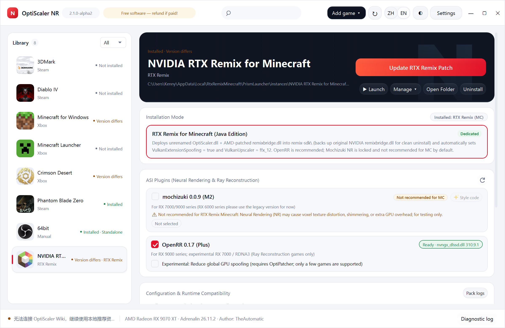

# RTX Remix for Minecraft - AMD Radeon Compatibility Patch

[English](#english) | [中文说明](#chinese)

> [!IMPORTANT]
> **源码公开 · 完全免费 · 严禁商业倒卖及收费代安装**（如付费购买请立即退款），详见[底部许可协议](#license-zh)。
>
> **Source-Available · Completely Free · No Commercial Resale or Paid Installation** (demand a refund if you paid for this). See [License & Terms](#license-en) below.

---

<a name="english"></a>
## English

This repository provides the native compatibility patch and bridge layer that enables **NVIDIA RTX Remix for Minecraft (Java Edition 1.21.1)** to run smoothly on **AMD Radeon graphics cards** (tested on AMD Radeon RX 9070 XT, RDNA 4 / gfx1201).

> [!TIP]
> **RX 9070 XT (4K DLSS Performance + Ray Reconstruction) Benchmark Highlight**: At the starting spot of the official RTX Demo map in native fullscreen (`1920×1080 → 3840×2160`), turning on Wave32 Sparse Rendering with [OpenRR-ASI](https://github.com/TheAutomatic/OpenRR-ASI) achieves **over 59 FPS (`58.9–59.1 FPS`)** — a **2.5×+ path-tracing core speedup** (`~25.9–27.7 ms → ~9.5 ms`), **~2.0× (doubled) actual in-game frame rate** over the initial AMD compatibility release (`28.4–28.7 FPS`), and **~310 MB lower VRAM** (`5697 MB → ~5390 MB`). See the full 11-round benchmark and `user.conf` guide in [docs/raytrace-mode-benchmark-9070xt.md](docs/raytrace-mode-benchmark-9070xt.md).

---

### Quick Start

First, install Minecraft Java Edition 1.21.1 and the official **RTX Remix for Minecraft** mod following [NVIDIAGameWorks/rtx-remix-minecraft](https://github.com/NVIDIAGameWorks/rtx-remix-minecraft). Then choose either one-click installation or manual placement:

#### Option 1 (Recommended): One-Click Installer ([dlss-5-amd-project](https://github.com/TheAutomatic/dlss-5-amd-project))

1. Download and open [dlss-5-amd-project](https://github.com/TheAutomatic/dlss-5-amd-project) (**OptiScaler NR Launcher**), then select **NVIDIA RTX Remix for Minecraft** on the left (PrismLauncher instances are detected automatically, or add your `.minecraft` folder manually).
2. Enable **OpenRR** and click install/update: the launcher automatically backs up NVIDIA's original `remixbridge.dll` for clean uninstall, deploys this patched `remixbridge.dll`, [OptiScaler](https://github.com/optiscaler/OptiScaler), and the full [OpenRR-ASI](https://github.com/TheAutomatic/OpenRR-ASI) AMD Ray Reconstruction plugin package, and enables `VulkanExtensionSpoofing = true` and `LoadAsiPlugins = true`.
3. Launch Minecraft and enable **Ray Reconstruction** in the RTX Remix graphics settings so Wave32 Sparse Rendering (~2× FPS) activates.



#### Option 2: Manual Installation (`remixbridge` + [OptiScaler](https://github.com/optiscaler/OptiScaler) + [OpenRR-ASI](https://github.com/TheAutomatic/OpenRR-ASI))

> [!NOTE]
> **OpenRR is NOT a single `.asi` file.** In addition to `openrr-amd.asi` (and its companion `openrr-ngx-host.dll`) inside the ASI plugins folder, OpenRR requires its full **`openrr-amd/`** directory (`shaders/`, precompiled `aco/`, `lang/`) placed right next to `OptiScaler.dll` inside `remix-sdk/`.

1. Separately download `remixbridge.dll` from this repository's [Releases](https://github.com/TheAutomatic/rtx-remix-minecraft-amd-patch/releases), any version of [OptiScaler](https://github.com/optiscaler/OptiScaler) (`v0.9.5+` recommended), and the full [OpenRR-ASI](https://github.com/TheAutomatic/OpenRR-ASI) AMD Ray Reconstruction plugin package.
2. Arrange `<instance>/.minecraft/remix-sdk/` as shown below *(`remix-sdk/OptiScaler/plugins/` is [OptiScaler](https://github.com/optiscaler/OptiScaler)'s default `Path = auto` folder; if your OptiScaler build uses a flat layout without an `OptiScaler/` subfolder, check `[Plugins] Path` in `OptiScaler.ini`, while always keeping `openrr-amd/` directly next to `OptiScaler.dll` inside `remix-sdk/`)*:
   ```text
   <instance>/.minecraft/
   ├── user.conf                          # Optional: recommended RX 9070 XT raytrace modes (below)
   ├── options.txt                        # Optional: fullscreen:true for native fullscreen
   └── remix-sdk/
       ├── d3d9.dll                       # Official DXVK-Remix runtime (unmodified)
       ├── nvngx_dlssd.dll                # Bundled with the official RTX Remix installation
       ├── remixbridge.dll                # <-- Replace with patched AMD remixbridge.dll
       ├── OptiScaler.dll                 # OptiScaler core (kept as OptiScaler.dll)
       ├── OptiScaler.ini                 # Configure VulkanExtensionSpoofing & ASI loading
       ├── OptiScaler/                    # OptiScaler companion libs & ASI plugins
       │   ├── amd_fidelityfx_*.dll
       │   └── plugins/
       │       ├── openrr-amd.asi         # OpenRR ASI entry plugin
       │       └── openrr-ngx-host.dll    # OpenRR NGX host helper (when bundled)
       └── openrr-amd/                    # Full OpenRR plugin data folder (next to OptiScaler.dll)
           ├── shaders/                   # SPIR-V kernels (*.spv)
           ├── aco/                       # Precompiled RDNA3/RDNA4 ACO caches
           └── lang/
   ```
3. In `remix-sdk/OptiScaler.ini`, ensure the following required keys are set:
   ```ini
   [Spoofing]
   VulkanExtensionSpoofing = true

   [Plugins]
   LoadAsiPlugins = true
   ```
   *(Since OpenRR takes over both ray reconstruction and upscaling directly in Vulkan, `VulkanUpscaler` does not need to be forced; only set `[Upscalers] VulkanUpscaler` manually if you disable Ray Reconstruction and want standard upscaling fallback).*

#### Recommended RX 9070 XT (RDNA4) `user.conf` Tuning

With Wave32 Sparse Rendering + OpenRR active, additionally overriding RTX Remix's default AMD `(0, 0, 2)` preset with full RGS `(2, 1, 2)` in `<instance>/.minecraft/user.conf` delivers the highest and steadiest frame rate (verified across 11 benchmark rounds):

```ini
rtx.raytraceModePreset = 0
rtx.renderPassGBufferRaytraceMode = 2
rtx.renderPassIntegrateDirectRaytraceMode = 1
rtx.renderPassIntegrateIndirectRaytraceMode = 2
```

- `rtx.raytraceModePreset = 0` (`Custom`) is required so `Auto` does not overwrite the three per-pass modes.
- Full benchmark data, frame-time breakdown, and pitfalls (e.g., avoid `rtx.graphicsPreset = 0` Ultra + `quality = 0.5` or `enableSparseVolumetricsPrimaryHit/Miss = True`) are documented in [docs/raytrace-mode-benchmark-9070xt.md](docs/raytrace-mode-benchmark-9070xt.md).

---

### Key Problems Solved

1. **WGL / Vulkan Window Swapchain Collision (`VK_ERROR_NATIVE_WINDOW_IN_USE_KHR`)**:
   - Minecraft Java Edition uses GLFW with WGL/OpenGL on its main window.
   - AMD's Vulkan ICD (`amdvlk64.dll`) strictly enforces Vulkan specification Section 34.1: creating a `VkSwapchainKHR` on an HWND with an active OpenGL/WGL Device Context fails with `VK_ERROR_NATIVE_WINDOW_IN_USE_KHR`.
   - **Solution**: The patched `remixbridge.dll` dynamically creates an independent, clean Win32 window (or child window `WS_CHILD | WS_CLIPSIBLINGS`) dedicated to Vulkan presentation, bypassing WGL DC collision entirely.

2. **Win32 Input & Focus Forwarding**:
   - Running path-traced rendering on a clean surface would normally disconnect mouse capture and keyboard events from Minecraft's GLFW window.
   - **Solution**: Implemented bidirectional message hooking and forwarding (`WM_MOUSEACTIVATE -> MA_NOACTIVATE`, raw mouse delta propagation, and focus synchronization), ensuring seamless 1st-person gameplay control.

3. **Bridge-Assisted Injection & [OptiScaler](https://github.com/optiscaler/OptiScaler) Integration**:
   - When running on AMD GPUs, DXVK-Remix's internal NGX wrapper fails with `0xbad00001` before calling `LoadLibrary("nvngx.dll")`, preventing standard proxy injection.
   - **Solution**: The custom bridge explicitly pre-loads `vulkan-1.dll` and `remix-sdk/OptiScaler.dll` prior to loading `d3d9.dll`. OptiScaler intercepts subsequent NGX calls and routes Vulkan Super Resolution / Ray Reconstruction to FSR or [OpenRR-ASI](https://github.com/TheAutomatic/OpenRR-ASI).

4. **NVX Vulkan Extension Spoofing (`m_dlssSupported` Gatekeeper)**:
   - RTX Remix's runtime (`rtx_context.cpp`) enforces a hardcoded check:
     ```cpp
     m_dlssSupported = (m_device->extensions().nvxBinaryImport &&
                        m_device->extensions().nvxImageViewHandle &&
                        m_device->extensions().khrPushDescriptor);
     ```
   - On AMD, these NVIDIA experimental extensions do not exist natively. Enabling `VulkanExtensionSpoofing = true` in `OptiScaler.ini` exposes the required extensions to Remix while safely filtering them out before physical device creation on AMD drivers.

5. **Wave32 RTX Sparse Rendering Unlock (`VK_EXT_subgroup_size_control` IAT Hook — **~2.5×+ Path-Tracing Speedup**, ~100% FPS Gain)**:
   - AMD's Windows Vulkan driver defaults `VkPhysicalDeviceSubgroupProperties::subgroupSize` to `64`, causing RTX Remix to forcefully disable Sparse Rendering (`compact_active_pixels.comp.slang requires 32`) and trace 100% of pixels instead of ~10%–30%.
   - **Solution**: `remixbridge.dll` patches `d3d9.dll`'s `vulkan-1.dll!vkGetInstanceProcAddr` IAT slot cleanly (isolated from OptiScaler, OpenRR, and LWJGL). On GPUs whose hardware capabilities confirm real Wave32 compute support (`minSubgroupSize <= 32 <= maxSubgroupSize`, `computeFullSubgroups`, `requiredSubgroupSizeStages` containing `VK_SHADER_STAGE_COMPUTE_BIT`), it enables `subgroupSizeControl` on `vkCreateDevice`, matches `compact_active_pixels` via structural SPIR-V inspection to compile it as true hardware **Wave32** (`requiredSubgroupSize = 32` + `REQUIRE_FULL_SUBGROUPS_BIT`), and reports `subgroupSize = 32` to `d3d9.dll`. Set `REMIX_AMD_SPARSE_WAVE32=0` to disable for A/B testing.
   - **Requirement & Measured Result**: **In-game Ray Reconstruction must be enabled** (e.g., via [OpenRR-ASI](https://github.com/TheAutomatic/OpenRR-ASI)) for RTX Remix to activate Sparse Rendering. With Wave32 Sparse Rendering + `(2, 1, 2)` + OpenRR (4K DLSS Performance), path-tracing time dropped from `~25.9–27.7 ms` to `~9.5 ms` (**~2.5×+ faster**), FPS jumped from `28.4–28.7` to **`58.9–59.1 FPS`**, and VRAM dropped by **~310 MB** (see [docs/raytrace-mode-benchmark-9070xt.md](docs/raytrace-mode-benchmark-9070xt.md) and [docs/next-steps-plan.md](docs/next-steps-plan.md)).

---

### Building from Source

**Prerequisites:**
- Windows 10/11 x64
- Visual Studio 2022 or Visual Studio Build Tools with C++ toolset (MSVC 14.3x or 14.4x)

**Build with MSVC Batch Script:**
```cmd
build.cmd
```
The compiled output will be generated at `bin/remixbridge.dll`.

**Build with CMake:**
```cmd
mkdir build && cd build
cmake .. -A x64
cmake --build . --config Release
```

---

<a name="license-en"></a>
### License, Anti-Resale Terms & Acknowledgements

- **Project License**: **PolyForm Noncommercial License 1.0.0** ([LICENSE](LICENSE), [NOTICE](NOTICE)).
  - Source code is publicly available and **completely free** for personal, hobbyist, research, and noncommercial use.
  - **Commercial resale prohibited**: Selling this software or its compiled binaries on any marketplace, bundling it in paid modpacks or paywalled groups/downloads, or providing it as part of paid "remote installation / setup / tuning" services is strictly prohibited. If you paid for this tool, request a refund immediately.
- **Upstream & Third-Party Attributions**:
  - Original RTX Remix JNI bridge code is derived from [NVIDIAGameWorks/rtx-remix-minecraft](https://github.com/NVIDIAGameWorks/rtx-remix-minecraft) under **Apache License 2.0** ([THIRD_PARTY_LICENSES/NVIDIA-rtx-remix-minecraft-Apache-2.0.txt](THIRD_PARTY_LICENSES/NVIDIA-rtx-remix-minecraft-Apache-2.0.txt) and [NOTICE](NOTICE)).
  - `include/remix_c.h` is licensed under the MIT License; OpenJDK JNI headers (`include/jni.h`, `include/win32/jni_md.h`) are licensed under GPL-2.0-only with Classpath Exception.
  - Thanks to [OptiScaler](https://github.com/optiscaler/OptiScaler) for upscaling / spoofing middleware support.

---

<a name="chinese"></a>
## 中文说明

本项目为 **NVIDIA RTX Remix for Minecraft (Java 版 1.21.1)** 的原生兼容补丁与 JNI 桥接层，使该全景光线追踪（Path Tracing）模组能够在 **AMD Radeon 显卡**（已在 AMD Radeon RX 9070 XT, RDNA 4 / gfx1201 上完整验证）上正常启动、流畅运行并开启光线重建与稀疏光追。

> [!TIP]
> **RX 9070 XT 实测成绩速览**：在 RTX 官方测试地图（`NVIDIA RTX Demo`）初始站位、真全屏 **4K DLSS 性能档（`1920×1080 → 3840×2160`）并开启光线重建（[OpenRR-ASI](https://github.com/TheAutomatic/OpenRR-ASI)）** 下，开启 Wave32 稀疏光追后稳态帧数已**超过 59 帧（`58.9–59.1 FPS`）**——相比仅解决可用性的初版（无稀疏 `28.4–28.7 FPS`），**路径光追主干提速约 2.5 倍+**（`~25.9–27.7 ms → ~9.5 ms`），**游戏实际帧数直接翻倍（~2.0×）**，同时进程显存实降约 **310 MB**（`5697 MB → ~5390 MB`）。完整 11 轮实测与 `user.conf` 调优见 [docs/raytrace-mode-benchmark-9070xt.md](docs/raytrace-mode-benchmark-9070xt.md)。

---

### 快速上手

请先按照 [NVIDIAGameWorks/rtx-remix-minecraft](https://github.com/NVIDIAGameWorks/rtx-remix-minecraft) 安装 Minecraft Java 版 1.21.1 及官方 **RTX Remix for Minecraft** 模组，然后任选下方一键安装或手动安装：

#### 方式一（推荐）：使用安装器一键部署（[dlss-5-amd-project](https://github.com/TheAutomatic/dlss-5-amd-project)）

1. 下载并打开 [dlss-5-amd-project](https://github.com/TheAutomatic/dlss-5-amd-project)（**OptiScaler NR Launcher**），在左侧列表选择 **NVIDIA RTX Remix for Minecraft**（自动识别 PrismLauncher 实例，也可手动添加 `.minecraft` 目录）。
2. 勾选 **OpenRR** 后点击安装 / 更新：启动器会自动备份原版 `remixbridge.dll`、部署本仓库适配版 `remixbridge.dll`、[OptiScaler](https://github.com/optiscaler/OptiScaler) 与完整的 [OpenRR-ASI](https://github.com/TheAutomatic/OpenRR-ASI) AMD 光线重建插件包，并自动配置好 `VulkanExtensionSpoofing = true` 与 `LoadAsiPlugins = true`。
3. 启动游戏后在 RTX Remix 画质设置中确认开启**光线重建（Ray Reconstruction）**，即可自动激活 Wave32 稀疏光追。


#### 方式二：手动安装（`remixbridge` + [OptiScaler](https://github.com/optiscaler/OptiScaler) + [OpenRR-ASI](https://github.com/TheAutomatic/OpenRR-ASI) 目录结构示意）

> [!IMPORTANT]
> **OpenRR 并不是单个 `.asi` 文件！** 除了插件目录下的 `openrr-amd.asi`（以及配套的 `openrr-ngx-host.dll`），还必须把完整的 **`openrr-amd/`** AMD 光线重建插件包目录（含 `shaders/`、`aco/`、`lang/` 等）一起放到 `remix-sdk/` 下与 `OptiScaler.dll` 同级，否则无法初始化光线重建。

1. 分别获取本仓库 [Releases](https://github.com/TheAutomatic/rtx-remix-minecraft-amd-patch/releases) 中的 `remixbridge.dll`、任意版本 [OptiScaler](https://github.com/optiscaler/OptiScaler)（推荐 `v0.9.5` 及以上）与完整的 [OpenRR-ASI](https://github.com/TheAutomatic/OpenRR-ASI) AMD 光线重建插件包。
2. 按下面示意摆好 `<实例目录>/.minecraft/remix-sdk/` 的文件与文件夹位置 *（`remix-sdk/OptiScaler/plugins/` 是 [OptiScaler](https://github.com/optiscaler/OptiScaler) `Path = auto` 时的默认插件目录；若你使用的构建不带 `OptiScaler/` 子目录，可按 `OptiScaler.ini` 中 `[Plugins] Path` 对应存放 `.asi` 插件，而 `openrr-amd/` 始终直接放在 `remix-sdk/` 下与 `OptiScaler.dll` 同级）*：
   ```text
   <实例目录>/.minecraft/
   ├── user.conf                          # 可选：写入下文 RX 9070 XT 推荐光追管线配置
   ├── options.txt                        # 可选：fullscreen:true 确保原生全屏
   └── remix-sdk/
       ├── d3d9.dll                       # 官方原版 DXVK-Remix 渲染器（无需修改）
       ├── nvngx_dlssd.dll                # 原版安装后自带
       ├── remixbridge.dll                # <-- 用本仓库编译/下载的 AMD 版覆盖替换
       ├── OptiScaler.dll                 # OptiScaler 核心库（保持原名 OptiScaler.dll）
       ├── OptiScaler.ini                 # 配置文件（扩展伪装 / ASI 加载）
       ├── OptiScaler/                    # OptiScaler 依赖库与 ASI 插件目录
       │   ├── amd_fidelityfx_*.dll       # FidelityFX / XeSS 等配套库
       │   └── plugins/
       │       ├── openrr-amd.asi         # OpenRR ASI 入口插件
       │       └── openrr-ngx-host.dll    # OpenRR 宿主配套库（如有随包提供）
       └── openrr-amd/                    # OpenRR 完整插件包目录（必须与 OptiScaler.dll 同级）
           ├── shaders/                   # SPIR-V 内核（*.spv）
           ├── aco/                       # RDNA3 / RDNA4 预编译 ACO 缓存
           └── lang/                      # 多语言文件
   ```
3. 编辑 `remix-sdk/OptiScaler.ini`，确认包含以下核心配置：
   ```ini
   [Spoofing]
   VulkanExtensionSpoofing = true

   [Plugins]
   LoadAsiPlugins = true
   ```
   *(说明：`VulkanExtensionSpoofing = true` 用于向 RTX Remix 暴露所需 Vulkan 扩展并解锁菜单中的 DLSS / 光线重建；`LoadAsiPlugins = true` 用于加载 OpenRR-ASI。开启 OpenRR 时超分与降噪已由 OpenRR 全权接管，无需强制配置 `VulkanUpscaler`；仅当手动关闭光线重建、想退回普通超分时才需自行指定 `VulkanUpscaler`)*。

#### RX 9070 XT（RDNA4）推荐 `user.conf` 光追管线配置

在 `<实例目录>/.minecraft/user.conf` 中设置以下 4 行（**必须保留 `rtx.raytraceModePreset = 0`**，避免被 `Auto` 覆盖），在开启或关闭稀疏光追下均为实测最快最稳组合（4K 性能档从无稀疏 ~30 FPS 翻倍至 **58.9–59.1 FPS**）：

```ini
rtx.raytraceModePreset = 0
rtx.renderPassGBufferRaytraceMode = 2
rtx.renderPassIntegrateDirectRaytraceMode = 1
rtx.renderPassIntegrateIndirectRaytraceMode = 2
```

完整 11 轮测试对比、耗时拆解及调优避坑（例如不要切 `rtx.graphicsPreset = 0` Ultra 叠加高采样或开启体积光稀疏开关）详见 [docs/raytrace-mode-benchmark-9070xt.md](docs/raytrace-mode-benchmark-9070xt.md)。

---

### 核心解决的技术痛点

1. **WGL / Vulkan 窗口交换链冲突 (`VK_ERROR_NATIVE_WINDOW_IN_USE_KHR`)**：
   - Minecraft Java 版使用 GLFW 创建基于 WGL/OpenGL 的游戏主窗口。
   - AMD 原生 Vulkan 驱动严格遵循 Vulkan 规范：当一个 HWND 已经挂载了非空的 OpenGL 设备上下文（DC）时，对其调用 `vkCreateSwapchainKHR` 将强制报出 `VK_ERROR_NATIVE_WINDOW_IN_USE_KHR` 并导致崩溃。
   - **解决机制**：重构 `remixbridge.dll`，在底层自动创建完全纯净的独立子窗口（`WS_CHILD | WS_CLIPSIBLINGS`）专供 Vulkan 交换链渲染，彻底规避 WGL DC 独占冲突。

2. **Win32 窗口消息与输入中继**：
   - 独立窗口渲染容易导致鼠标独占失效、光标错位或无法操作游戏。
   - **解决机制**：实现了全套 Win32 消息透传与焦点重定向（`WM_MOUSEACTIVATE -> MA_NOACTIVATE`、原生鼠标 Delta 增量转发与焦点同步），确保第一人称视角无缝操控与正常游玩。

3. **桥接器引导式预加载（解决 A 卡 [OptiScaler](https://github.com/optiscaler/OptiScaler) 注入）**：
   - 在 A 卡环境下，RTX Remix 的 `d3d9.dll` 会直接返回 `0xbad00001` 并提前退出，根本不会触发对 `nvngx.dll` 的加载，导致常规 Hook 方式全部失效。
   - **解决机制**：定制版桥接器在加载 `d3d9.dll` 前，显式调用系统 `vulkan-1.dll` 并加载 `remix-sdk/OptiScaler.dll`，抢先在进程中安装 Vulkan 钩子，成功接管后续 NGX 调用并转接至 FSR 或 [OpenRR-ASI](https://github.com/TheAutomatic/OpenRR-ASI)。

4. **NVX Vulkan 扩展伪装（绕过 `m_dlssSupported` 门禁）**：
   - RTX Remix 的渲染管线源码（`rtx_context.cpp`）硬编码要求物理设备必须同时支持 `VK_NVX_binary_import` 和 `VK_NVX_image_view_handle`，否则每帧内部计算 `m_dlssSupported == false` 并强行关闭 DLSS 调度。
   - **解决机制**：在 `OptiScaler.ini` 中启用 `VulkanExtensionSpoofing = true`，向 Remix 暴露对应 NVX 扩展使门禁通过，并在底层创建真实设备时安全剔除，保证 AMD 驱动稳定运行。

5. **AMD Wave32 稀疏光追解锁（`VK_EXT_subgroup_size_control` 隔离 IAT Hook —— **光追性能提升 2.5 倍+**，游戏帧数翻倍）**：
   - AMD Windows Vulkan 驱动默认汇报 `subgroupSize = 64`，导致 RTX Remix 强制禁用稀疏光追（`compact_active_pixels.comp.slang requires 32`），被迫对 100% 像素全量追踪。
   - **解决机制**：`remixbridge.dll` 仅针对 `d3d9.dll` 的 `vulkan-1.dll!vkGetInstanceProcAddr` IAT 进行隔离拦截（不干扰 OptiScaler、OpenRR 与 LWJGL）。在确认物理设备真实具备 Wave32 能力（`minSubgroupSize <= 32 <= maxSubgroupSize`、`computeFullSubgroups` 且支持 Compute 阶段指定波前宽度）时，自动在 `vkCreateDevice` 启用 `subgroupSizeControl`、通过 SPIR-V 结构识别精准锁定 `compact_active_pixels` 强制以真硬件 **Wave32**（`requiredSubgroupSize = 32` + `REQUIRE_FULL_SUBGROUPS_BIT`）编译执行，并仅向 `d3d9.dll` 放行 `subgroupSize = 32` 门禁（可通过环境变量 `REMIX_AMD_SPARSE_WAVE32=0` 一键关闭对比）。
   - **生效条件与实测收益**：**必须在游戏内开启光线重建（如 [OpenRR-ASI](https://github.com/TheAutomatic/OpenRR-ASI)）**，RTX Remix 引擎才会启用稀疏光追。配合 `(2, 1, 2)` 与 OpenRR（4K DLSS 性能档），路径光追主干耗时从 `~25.9–27.7 ms` 降至 `~9.5 ms`（**提速 2.5 倍+**），稳态帧数从 `28.4–28.7` 跃升至 **`58.9–59.1 FPS`（翻倍）**，Compact GBuffer 同步节省约 **310 MB** 显存。详见 [docs/raytrace-mode-benchmark-9070xt.md](docs/raytrace-mode-benchmark-9070xt.md)（后续计划见 [docs/next-steps-plan.md](docs/next-steps-plan.md)）。

---

### 源码编译

**环境要求：**
- Windows 10/11 64位
- 安装了 C++ 工具集的 Visual Studio 2022 或 Visual Studio Build Tools (MSVC 14.3x / 14.4x)

**使用脚本一键编译：**
```cmd
build.cmd
```
产物将生成在 `bin/remixbridge.dll`。

---

<a name="license-zh"></a>
### 许可协议、防倒卖声明与鸣谢

- **本项目授权协议**：**PolyForm Noncommercial License 1.0.0**（详见 [LICENSE](LICENSE) 与 [NOTICE](NOTICE)）。
  - 源码公开，**完全免费**提供给个人用户非商业使用、学习与研究。
  - **严禁商业倒卖**：禁止在闲鱼、淘宝、拼多多等任何平台有偿售卖本软件及其编译产物，禁止打进收费整合包或付费网盘/付费群分发，**严禁以“收费代安装 / 远程调试 / 付费优化”等名义向他人有偿提供本工具**。如您是付费购买所得，请立即申请退款！
- **上游与第三方归属**：
  - 上游原始桥接代码来自 [NVIDIAGameWorks/rtx-remix-minecraft](https://github.com/NVIDIAGameWorks/rtx-remix-minecraft)，保留其 **Apache License 2.0** 授权（见 [THIRD_PARTY_LICENSES/NVIDIA-rtx-remix-minecraft-Apache-2.0.txt](THIRD_PARTY_LICENSES/NVIDIA-rtx-remix-minecraft-Apache-2.0.txt) 及 [NOTICE](NOTICE)）。
  - `include/remix_c.h` 采用 MIT 协议，OpenJDK JNI 头文件采用 GPL-2.0-only WITH Classpath-exception-2.0 协议。
  - 感谢 [OptiScaler](https://github.com/optiscaler/OptiScaler) 提供的中间层转接能力。
